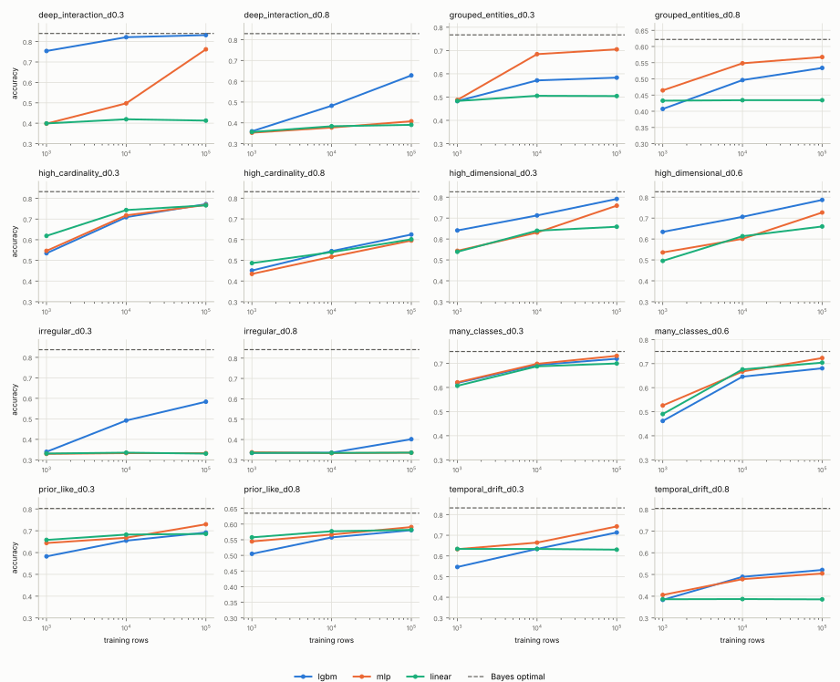

# Iteration 1: a generator for tables outside the TabICL prior, with CPU baselines

Date: 2026-11-09. Code: `tabicl-hard-synth/hardsynth/`. Grid: `suite.yaml`, `smoke`.

## Goal

Build synthetic tables (up to 10M rows) on which TabICL is expected to lose
to gradient-boosted trees or an MLP, so that the next iterations can ask:
at which data size, and how far from the pre-training prior, does
fine-tuning TabICL pay for itself instead of falling back to LightGBM or an
MLP?

## What "outside the prior" means here

The released `tabicl` package (2.2.0) ships the pre-training prior
(`tabicl.prior`). Reading its defaults and the TabICLv2 training recipe gives
a concrete picture of the data the model has seen:

| prior property | TabICLv2 pre-training | where real data leaves it (BeyondArena) |
|---|---|---|
| rows per table | 400 to about 60 000 (log-uniform in the last training stages) | tables with >= 100k rows, up to 1M |
| columns | 2 to 100 | up to 22k |
| classes | at most 10 | many-class tasks |
| categorical levels | mostly 2 to 9, at most 200 | high-cardinality ids, free text |
| row structure | IID rows | temporal splits, grouped (unseen-entity) splits |
| target functions | random graph SCMs with 8 function types (MLP, GP, tree, discretisation, ...) chosen to span smoothness levels; noise only through unobserved node dimensions | irregular, high-frequency, deep interactions |
| feature scale | standardised, clipped at 4 std at inference | heavy tails, outliers |

BeyondArena (arXiv:2606.30410; 142 datasets, 11 models, Elo calibrated so
that a default XGBoost scores 1000) defines its sub-benchmarks as: Tiny
100 <= n <= 1k, Small 1k < n <= 10k, Medium 10k < n <= 100k, Large
n > 100k training rows; Low <= 100 and High > 100 columns after
preprocessing; High Card. = at least one categorical column with more than
50 categories; plus Text, IID, Temporal and Grouped. Datasets with more
than 1.25M rows are subsampled to 1M training rows. TabPFN-2.6 and TabDPT
were only run up to 100k rows; TabICLv2 ran everywhere, with its ensemble
reduced to one member on the 5 largest datasets.

Its findings, as far as they matter for this generator:

* Tuned RealMLP leads the overall leaderboard (Elo 1283), ahead of
  TabPFN-2.6 (1224), TabM, CatBoost and TabICLv2 (1205). TFMs rank highest
  by default performance and win or tie on 70% of the datasets, but trail
  tuned traditional models on the non-IID, Large, High-dim and High Card.
  sub-benchmarks.
* A regression of the best TFM's rank on the dataset properties finds only
  two significant effects: more than 100k training rows (+8.0 ranks of 28,
  p < 0.001) and grouped splits (+5.9, p < 0.001). Temporal, high
  dimensionality and high cardinality are significant on their own but
  not once size is controlled for, because 57%, 35% and 43% of those
  datasets are large. The paper itself notes that the sub-benchmarks
  overlap and cannot separate the axes.
* TFMs were evaluated with in-context learning only; fine-tuning is
  listed as a limitation and left open. That is the gap this experiment
  targets.
* For grouped data, BeyondArena drops the group index column for
  label-per-sample datasets "to prevent models from overfitting to it".

### Leaderboard update after the paper (core2k protocol, retrieved 2026-11-10)

The live BeyondArena tab of the TabArena leaderboard
(https://huggingface.co/spaces/TabArena/leaderboard, Space revision
`d77ab823522c`, 2026-11-09) has moved on from the paper in two ways: it uses
the core2k protocol (2 000 splits instead of the paper's 507-split core
subset) and it has 42 entries, including tabular foundation models that
were released after the paper: Kumo-Tabular (NVIDIA, three sizes),
TabPFN-3.5 and TabPFN-3.5-Fast, Seldon, Causilo, LimiX-2, TabFM, EXAONE-Tabular,
RealTabPFN-2.5, TabDPT-1.3 and TabSwift. The CSVs behind the tab are
snapshotted in [`beyondarena_leaderboard/`](beyondarena_leaderboard/README.md).
Elo, with the rank among the 42 entries; dataset counts per subset in the
header; `imp.` marks results imputed with a default RandomForest where a
model could not run:

| model | All (142) | Tiny (52) | Small (38) | Medium (30) | Large (22) | IID (103) | Temporal (21) | Grouped (18) | High-dim (51) | High-card. (30) | Text (16) |
|---|---|---|---|---|---|---|---|---|---|---|---|
| Kumo-Tabular | 1430 (#1) | 1497 (#1) | 1608 (#1) | 1542 (#1) | 1162 (#8) | 1576 (#1) | 1176 (#1) | 1221 (#4) | 1405 (#1) | 1302 (#1) | 1464 (#1) |
| TabPFN-3.5 | 1372 (#3) | 1443 (#4) | 1492 (#6) | 1453 (#2) | 1164 (#7) | 1498 (#4) | 1174 (#2) | 1157 (#14) | 1290 (#3) | 1281 (#2) | 1445 (#2) |
| Seldon | 1358 (#4) | 1461 (#3) | 1533 (#4) | 1408 (#4) | 1030 (#16) | 1518 (#2) | 1052 (#17) | 1135 (#18) | 1253 (#5) | 1179 (#4) | 1338 (#6) |
| Causilo | 1321 (#5) | 1436 (#6) | 1442 (#9) | 1360 (#7) | 1006 (#17) | 1434 (#6) | 1055 (#16) | 1202 (#6) | 1255 (#4) | 1124 (#9) | 1361 (#5) |
| LimiX-2 | 1289 (#9) [15% imp.] | 1392 (#11) | 1606 (#2) | 1381 (#5) | not run | 1428 (#9) [6% imp.] | 944 (#26) [57% imp.] | 1139 (#17) [22% imp.] | 1105 (#18) [35% imp.] | 991 (#21) [43% imp.] | 1192 (#10) [31% imp.] |
| TabFM | 1273 (#10) [15% imp.] | 1406 (#10) | 1518 (#5) | 1333 (#9) | not run | 1405 (#10) [6% imp.] | 914 (#28) [57% imp.] | 1150 (#15) [22% imp.] | 1102 (#19) [35% imp.] | 943 (#23) [43% imp.] | 1178 (#11) [31% imp.] |
| TabPFN-3 | 1229 (#12) | 1347 (#12) | 1349 (#12) | 1215 (#13) | 913 (#24) | 1332 (#12) | 1024 (#18) | 1048 (#28) | 1111 (#16) | 1030 (#18) | 1147 (#17) |
| TabPFN-2.6 | 1172 (#14) [15% imp.] | 1313 (#15) | 1327 (#13) | 1142 (#17) | 716 (#27) [95% imp.] | 1256 (#14) [6% imp.] | 950 (#25) [51% imp.] | 1071 (#25) [22% imp.] | 1065 (#24) [33% imp.] | 860 (#29) [43% imp.] | 1120 (#21) [25% imp.] |
| **TabICLv2** | 1167 (#17) | 1340 (#13) | 1286 (#14) | 1103 (#22) | 707 (#28) | 1279 (#13) | 817 (#30) | 1055 (#27) | 981 (#29) | 865 (#28) | 1075 (#25) |
| TabDPT-1.3 | 1121 (#23) [15% imp.] | 1318 (#14) | 1210 (#17) | 1007 (#28) | not run | 1226 (#16) [6% imp.] | 787 (#31) [57% imp.] | 999 (#36) [22% imp.] | 884 (#32) [35% imp.] | 742 (#32) [43% imp.] | 868 (#32) [31% imp.] |
| RealMLP (T+E) | 1223 (#13) | 1278 (#17) | 1247 (#16) | 1216 (#12) | 1274 (#1) | 1250 (#15) | 1172 (#3) | 1246 (#1) | 1199 (#8) | 1153 (#6) | 1227 (#9) |
| TabM (T+E) | 1171 (#15) | 1243 (#19) | 1188 (#18) | 1136 (#18) | 1172 (#5) | 1192 (#18) | 1081 (#12) | 1241 (#2) | 1141 (#10) | 1057 (#17) | 1135 (#19) |
| CatBoost (T+E) | 1170 (#16) | 1218 (#23) | 1181 (#19) | 1182 (#14) | 1177 (#4) | 1190 (#19) | 1132 (#5) | 1183 (#10) | 1134 (#12) | 1152 (#7) | 1165 (#12) |
| LightGBM (T+E) | 1148 (#20) | 1189 (#26) | 1171 (#20) | 1128 (#20) | 1190 (#2) | 1153 (#23) | 1129 (#7) | 1216 (#5) | 1140 (#11) | 1082 (#15) | 1154 (#13) |
| XGBoost (T+E) | 1111 (#26) | 1118 (#33) | 1128 (#25) | 1132 (#19) | 1169 (#6) | 1122 (#26) | 1129 (#6) | 1094 (#22) | 1115 (#15) | 1113 (#11) | 1143 (#18) |
| XGBoost (default) | 1000 (#32) | 1000 (#42) | 1000 (#32) | 1000 (#29) | 1000 (#18) | 1000 (#33) | 1000 (#21) | 1000 (#34) | 1000 (#27) | 1000 (#20) | 1000 (#29) |

What changed, and what did not:

* **TabICLv2 is far behind on every axis this generator targets.** It is
  17th overall (Elo 1167) and sits *below the default XGBoost* (1000) on
  Large (707), Temporal (817), High-cardinality (865) and High-dimensional
  (981) data, 27th on Grouped (1055). On Tiny and Small data it is still
  13th and 14th. The same pattern holds for the other open-weight models of
  its generation (TabPFN-2.6, TabDPT).
* **Newer foundation models have closed the temporal, high-dimensional,
  high-cardinality and text gaps.** Kumo-Tabular is first on every subset
  except Large (8th, 1162) and Grouped (4th, 1221); TabPFN-3.5 is second on
  Temporal, High-cardinality and Text. This agrees with the paper's own
  regression: those axes were confounded with size, and a better prior and
  preprocessing fix them zero-shot.
* **Large and grouped data remain open for every foundation model.** On
  Large, tuned and ensembled RealMLP (1274), LightGBM (1190), CatBoost
  (1177), TabM (1172) and XGBoost (1169) all rank above the best foundation
  models (TabPFN-3.5 1164, Kumo-Tabular 1162). On Grouped, RealMLP (1246)
  and TabM (1241) lead, with Kumo-Tabular fourth. This is exactly the
  paper's conclusion, now confirmed against models it did not have.
* **Licences matter for the fine-tuning question.** TabICLv2 is BSD-3 with
  open pre-training and fine-tuning code. Kumo-Tabular is OpenMDW-1.1;
  TabPFN-3.5, Seldon and Causilo are under non-commercial or research
  licences. Fine-tuning TabICLv2 is therefore the only fully open route,
  and the newer models serve as a reference for what a prior can reach
  zero-shot rather than as drop-in replacements.

Consequences for this experiment:

1. The families map one-to-one onto leaderboard subsets where TabICLv2 is
   weakest: `deep_interaction` to Large, `grouped_entities` to Grouped,
   `temporal_drift` to Temporal, `high_cardinality` to High-cardinality,
   `high_dimensional` to High-dimensional. The CPU results above reproduce
   the ordering: TabICLv2 is competitive at equal rows on IID-like
   families and weakest on grouped, high-cardinality and drifting data.
2. For temporal, high-cardinality and high-dimensional data the leaderboard
   shows that a foundation model *can* handle them zero-shot, so
   prior-extension fine-tuning of TabICLv2 (continued pre-training on
   synthetic tables with these properties) has a known target. For Large and
   Grouped no foundation model has closed the gap, so per-dataset
   fine-tuning is the only candidate and the fallback remains the expected
   answer.
3. The fallback in the next iteration should be RealMLP, tuned and
   ensembled, in addition to LightGBM: it is the top model on both open
   subsets.

A synthetic generator with one knob per axis can do what the benchmark
cannot: vary size, grouping, drift, width, cardinality and target
irregularity independently, at any number of rows, with the Bayes error
known.

## The eight families

Each family has a single `difficulty` knob in [0, 1]. At 0 the family is
close to the prior; at 1 it is far outside. All families share `n_samples`,
`n_features`, `task`, `n_classes`, `label_noise`, `imbalance` and `seed`.

| family | axis | difficulty 0 -> 1 | split |
|---|---|---|---|
| `prior_like` | control, inside the prior | label noise std 0.1 -> 1.0 | random |
| `deep_interaction` | large data / high-order interactions: target is a random lookup table over the joint discretisation of k features | 9 -> 1.7M table cells; table weight 0.5 -> 1.0 | random |
| `high_cardinality` | level-specific effects of Zipf-distributed categoricals plus a hashed pair interaction | 3 columns x 10 levels -> 6 x 10 000 levels; pair weight 0 -> 1 | random |
| `many_classes` | Gaussian class clusters in an 8-d latent space, injective warp to 20 observed features, noise features | 10 -> 500 classes; Bayes accuracy calibrated to 0.75 | random |
| `high_dimensional` | 20 informative columns under 16 random ReLU units and products; half the rest are low-rank confounders, half noise; Student-t marginals | 100 -> about 3 000 columns; t(10) -> t(2) | random |
| `temporal_drift` | feature means drift along sine curves, the coefficient vector rotates with time, a seasonal term; `time` is a feature | no drift -> 2 std mean drift, 90 degree rotation, season weight 1 | last rows |
| `grouped_entities` | rows belong to entities with observed covariates, individual x entity interactions and an unobserved entity effect; `group_id` is a feature | 100 -> 10 000 training entities; unobserved effect std 0 -> 1 | unseen entities |
| `irregular` | sums of high-frequency sinusoids plus a parity (XOR) of sign bits | 0.5 -> 8 cycles per std; parity of 2 -> 6 bits, weight 0 -> 1 | random |

Every family exposes the Bayes-optimal reference per row: `_p_bayes`, the
largest class posterior, for classification, and `_y_clean` = E[y | x] for
regression. For the latent-threshold families the posterior is exact under
the Gaussian label noise; for `many_classes` it is exact because the warp
from latent to observed space is injective; for `grouped_entities` it is
the unseen-entity oracle that does not know the entity's random effect.
Learning curves can therefore be read as "distance to the ceiling", not
only as "model A vs model B".

### Why these should be hard for in-context learning but not for trees

* `deep_interaction`: with b^k independent cell values, a learner needs on
  the order of 10 x b^k rows to resolve the table. At difficulty 0.8 there
  are 78 125 cells, so accuracy keeps improving up to about 1M rows. An
  in-context learner sees at most its context (TabICL recommends <= 100k
  rows, the pre-training prior never exceeded 60k); the rows beyond the
  context are simply unused unless the model is fine-tuned.
* `high_cardinality`: TabICL ordinal-encodes categoricals and warns above
  40 levels; the prior has at most 200 levels and typically < 10. LightGBM
  handles the levels natively and the MLP uses target encoding.
* `many_classes`: above 10 classes TabICL falls back to hierarchical
  classification over class subsets.
* `high_dimensional` and `irregular`: the prior's functions are smooth
  tree/MLP/GP mixtures with <= 100 columns; heavy tails are clipped at 4
  std, which destroys the signal in the tails.
* `temporal_drift` and `grouped_entities`: in-context learning weights all
  context rows equally and has no notion of recency or of an entity; trees
  split on `time` and MLPs extrapolate the smooth drift at least locally.
  These two families also test memorisation: the `group_id` column lets a
  model fit entity effects that do not transfer to unseen entities.

## Generation cost

`python -m hardsynth.generate --family deep_interaction --difficulty 0.8
--n-samples 10_000_000 --test-size 200_000 --n-classes 3`: 10M rows x 30
features in 22 s on this 4-core cloud VM (numpy 2.5.3, pyarrow, zstd
Parquet), 1.3 GB on disk, chunks of 1M rows so peak memory stays below
1 GB. The wide family is the exception: 10M x 3 000 float32 would be 120 GB,
so the `full` grid caps it at 0.5M to 1M rows.

## Baselines on the smoke grid (300k rows, CPU)

Setup: every family at two difficulties (`suite.yaml`, grid `smoke`),
300 000 rows of which the last 50 000 are the test split, 3 classes, label
noise 0.3, seed 0. Learning curves over random training subsets of 1k, 10k
and 100k rows. Models with their default-ish settings, no tuning:

* LightGBM 4.x: 1000 trees, learning rate 0.05, 63 leaves, 80% row/column
  subsampling, early stopping (50 rounds) on 10% of the training subset,
  categoricals handled natively.
* MLP: scikit-learn `MLPClassifier`, two hidden layers of 256, Adam,
  early stopping; numerics standardised, categoricals target-encoded.
* linear: logistic regression on the same preprocessing.

TabICL (zero-shot in-context learning, checkpoint
`tabicl-classifier-v2-20260212`, package 2.2.0) was run on the CPU of the
same VM after the Hugging Face hosts were allowed: 4 ensemble members
instead of the default 8, one member per forward pass, contexts of 1k and
10k rows, 5 000 test rows (the two wide datasets only at 1k context). A 10k
context takes about 7 minutes per dataset on 4 cores, so 100k contexts and
fine-tuning are left to the GPU follow-up.

Hardware: 4 vCPU cloud VM, 15 GB RAM, Linux; Python 3.12, numpy 2.5.3,
scikit-learn and LightGBM from conda-forge (exact versions in each
`results.json`).

Command:

```bash
pixi run suite --grid smoke --data-dir data --evaluate \
    --out journal/2026-11-09-generator-baselines \
    --models lgbm mlp linear --train-sizes 1000 10000 100000 --test-rows 50000
```

### Results

Best test accuracy per model over the three training sizes; in brackets the
change from 10k to 100k training rows (the "does more data still help"
signal). Bayes is the accuracy of the true posterior on the test split.
With 50 000 test rows the standard error of an accuracy is about 0.002; the
TabICL numbers use a 5 000-row subsample of the same split (standard error
about 0.007).

| dataset | family | difficulty | metric | Bayes | LightGBM | MLP | linear | TabICL | TabICL-ft |
|---|---|---|---|---|---|---|---|---|---|
| deep_interaction_d0.3 | deep_interaction | 0.30 | accuracy | 0.840 | 0.832 (+0.010 at 100,000) | 0.762 (+0.265 at 100,000) | 0.419 (-0.007 at 100,000) |  |  |
| deep_interaction_d0.8 | deep_interaction | 0.80 | accuracy | 0.829 | 0.628 (+0.146 at 100,000) | 0.408 (+0.030 at 100,000) | 0.390 (+0.007 at 100,000) |  |  |
| grouped_entities_d0.3 | grouped_entities | 0.30 | accuracy | 0.767 | 0.583 (+0.012 at 100,000) | 0.705 (+0.021 at 100,000) | 0.505 (-0.001 at 100,000) |  |  |
| grouped_entities_d0.8 | grouped_entities | 0.80 | accuracy | 0.622 | 0.534 (+0.038 at 100,000) | 0.567 (+0.019 at 100,000) | 0.434 (-0.000 at 100,000) |  |  |
| high_cardinality_d0.3 | high_cardinality | 0.30 | accuracy | 0.833 | 0.772 (+0.063 at 100,000) | 0.769 (+0.051 at 100,000) | 0.767 (+0.023 at 100,000) |  |  |
| high_cardinality_d0.8 | high_cardinality | 0.80 | accuracy | 0.831 | 0.624 (+0.080 at 100,000) | 0.596 (+0.079 at 100,000) | 0.601 (+0.062 at 100,000) |  |  |
| high_dimensional_d0.3 | high_dimensional | 0.30 | accuracy | 0.826 | 0.792 (+0.079 at 100,000) | 0.759 (+0.128 at 100,000) | 0.659 (+0.019 at 100,000) |  |  |
| high_dimensional_d0.6 | high_dimensional | 0.60 | accuracy | 0.826 | 0.787 (+0.081 at 100,000) | 0.727 (+0.126 at 100,000) | 0.660 (+0.047 at 100,000) |  |  |
| irregular_d0.3 | irregular | 0.30 | accuracy | 0.837 | 0.584 (+0.092 at 100,000) | 0.333 (-0.000 at 100,000) | 0.335 (-0.005 at 100,000) |  |  |
| irregular_d0.8 | irregular | 0.80 | accuracy | 0.842 | 0.402 (+0.066 at 100,000) | 0.337 (+0.002 at 100,000) | 0.335 (+0.001 at 100,000) |  |  |
| many_classes_d0.3 | many_classes | 0.30 | accuracy | 0.749 | 0.719 (+0.026 at 100,000) | 0.731 (+0.033 at 100,000) | 0.699 (+0.012 at 100,000) |  |  |
| many_classes_d0.6 | many_classes | 0.60 | accuracy | 0.750 | 0.680 (+0.035 at 100,000) | 0.723 (+0.056 at 100,000) | 0.704 (+0.028 at 100,000) |  |  |
| prior_like_d0.3 | prior_like | 0.30 | accuracy | 0.802 | 0.692 (+0.037 at 100,000) | 0.730 (+0.062 at 100,000) | 0.686 (+0.003 at 100,000) |  |  |
| prior_like_d0.8 | prior_like | 0.80 | accuracy | 0.635 | 0.581 (+0.023 at 100,000) | 0.591 (+0.024 at 100,000) | 0.582 (+0.005 at 100,000) |  |  |
| temporal_drift_d0.3 | temporal_drift | 0.30 | accuracy | 0.832 | 0.713 (+0.079 at 100,000) | 0.743 (+0.078 at 100,000) | 0.634 (-0.003 at 100,000) |  |  |
| temporal_drift_d0.8 | temporal_drift | 0.80 | accuracy | 0.804 | 0.521 (+0.032 at 100,000) | 0.505 (+0.026 at 100,000) | 0.387 (-0.001 at 100,000) |  |  |



Markers distinguish the models where curves coincide (on `irregular` the
MLP and the linear model both sit at chance).

Per-dataset plots and raw numbers are in `<dataset>/learning_curve.svg` and
`<dataset>/results.json`.

### TabICL zero-shot against the baselines at equal and unequal data

Accuracy at 1k and 10k training rows for TabICL, LightGBM and the MLP,
then the best baseline at 100k rows, and TabICL's predict time for 5 000
test rows with a 10k context on 4 CPU cores. Bold marks the best model at
10k rows.

| dataset | Bayes | TabICL 1k | LightGBM 1k | MLP 1k | TabICL 10k | LightGBM 10k | MLP 10k | best baseline 100k | TabICL s/5k rows |
|---|---|---|---|---|---|---|---|---|---|
| prior_like_d0.3 | 0.802 | 0.667 | 0.582 | 0.644 | **0.688** | 0.655 | 0.668 | 0.730 (MLP) | 433 |
| prior_like_d0.8 | 0.635 | 0.570 | 0.505 | 0.545 | **0.595** | 0.557 | 0.567 | 0.591 (MLP) | 429 |
| deep_interaction_d0.3 | 0.840 | 0.790 | 0.754 | 0.398 | 0.819 | **0.822** | 0.498 | 0.832 (LightGBM) | 428 |
| deep_interaction_d0.8 | 0.829 | 0.424 | 0.359 | 0.353 | **0.549** | 0.482 | 0.377 | 0.628 (LightGBM); 0.741 at 1M | 434 |
| irregular_d0.3 | 0.837 | 0.424 | 0.339 | 0.329 | **0.530** | 0.492 | 0.333 | 0.584 (LightGBM) | 417 |
| irregular_d0.8 | 0.842 | 0.345 | 0.334 | 0.337 | 0.329 | 0.335 | 0.333 | 0.402 (LightGBM) | 419 |
| high_cardinality_d0.3 | 0.833 | 0.593 | 0.535 | 0.546 | 0.645 | 0.709 | **0.718** | 0.772 (LightGBM) | 421 |
| high_cardinality_d0.8 | 0.831 | 0.466 | 0.451 | 0.434 | 0.511 | **0.544** | 0.517 | 0.624 (LightGBM) | 410 |
| high_dimensional_d0.3 | 0.826 | 0.675 | 0.641 | 0.544 | not run | **0.713** | 0.631 | 0.792 (LightGBM) | 263 (1k context) |
| high_dimensional_d0.6 | 0.826 | 0.626 | 0.634 | 0.536 | not run | **0.706** | 0.601 | 0.787 (LightGBM) | 804 (1k context) |
| many_classes_d0.3 | 0.749 | 0.665 | 0.619 | 0.621 | **0.722** | 0.693 | 0.698 | 0.731 (MLP) | 580 |
| many_classes_d0.6 | 0.750 | 0.582 | 0.462 | 0.526 | **0.704** | 0.646 | 0.667 | 0.723 (MLP) | 690 |
| temporal_drift_d0.3 | 0.832 | 0.675 | 0.546 | 0.633 | **0.681** | 0.634 | 0.664 | 0.743 (MLP) | 404 |
| temporal_drift_d0.8 | 0.804 | 0.366 | 0.383 | 0.406 | 0.404 | **0.489** | 0.478 | 0.521 (LightGBM) | 415 |
| grouped_entities_d0.3 | 0.767 | 0.529 | 0.483 | 0.488 | 0.550 | 0.572 | **0.684** | 0.705 (MLP) | 403 |
| grouped_entities_d0.8 | 0.622 | 0.471 | 0.407 | 0.465 | 0.443 | 0.496 | **0.548** | 0.567 (MLP) | 412 |

Three things stand out.

1. **At equal rows TabICL is the most sample-efficient model on most
   families.** With 10k rows it is best or tied on 9 of 14 datasets,
   including the hard deep-interaction and irregular targets where it is
   0.04 to 0.07 ahead of LightGBM. It loses at equal rows exactly where
   BeyondArena's regression found the significant effects and where its
   preprocessing is weak: grouped entities (0.13 and 0.10 behind the
   target-encoding MLP; at difficulty 0.8 its accuracy even drops from 1k
   to 10k context, the signature of memorising `group_id`), high-cardinality
   categoricals (0.07 and 0.03 behind LightGBM) and strong temporal drift
   (0.08 behind LightGBM).
2. **A baseline with 10x more rows beats TabICL's 10k context on 15 of 16
   datasets**; the exception, `prior_like_d0.8`, is a tie. The margin is
   largest where the learning curves are steep: 0.08 on
   `deep_interaction_d0.8` (0.19 against LightGBM at 1M rows), 0.13 on
   `high_cardinality_d0.3`, 0.15 on `grouped_entities_d0.3`, 0.12 on
   `temporal_drift_d0.8`. TabICL's own 1k to 10k gain is 0.10 to 0.12 on
   the deep-interaction, irregular and many-class datasets, so its curve
   is still rising where the context stops. This is the regime the
   fine-tuning study is about: the rows exist, the zero-shot model cannot
   consume them.
3. **Cost.** On 4 CPU cores TabICL needs about 400 s to predict 5 000 rows
   with a 10k context (600 to 700 s with 32 to 105 classes, 800 s for the
   794-column dataset at 1k context), against about 3 s for LightGBM to fit
   and predict at 10k rows and 15 to 30 s at 100k. A GPU changes the
   absolute numbers by two orders of magnitude but not the comparison with
   a tree model fitted on ten times the data.

### Reading the curves

* **Control (`prior_like`)**: all three models sit 0.05 to 0.11 below the
  Bayes line at 100k rows and gain only 0.02 to 0.06 per decade. The random
  3-layer tanh MLP latent is not trivial, but nothing here is outside the
  prior. Zero-shot TabICL is the best model at 1k and 10k rows here
  (0.688 at 10k, Bayes 0.802), but the MLP overtakes it with 100k rows.
  If fine-tuning buys nothing on this family, the cost comparison has its
  baseline.
* **`deep_interaction`**: at difficulty 0.3 LightGBM reaches the Bayes line
  by 100k rows (0.832 vs 0.840) while the MLP jumps from 0.50 to 0.76 between
  10k and 100k rows. At difficulty 0.8, where 74% of the variance sits in
  4th- and 5th-order interactions over 3 125 cells, LightGBM is at 0.63 and
  still gaining 0.15 per decade; the MLP has barely left chance.
  A separate 1.1M-row version of the same dataset, LightGBM only
  ([learning curve](deep_interaction_d0.8_1M/learning_curve.svg), not part
  of the grid figure above), confirms the trend: LightGBM goes from 0.48
  (10k rows) to 0.63 (100k) to 0.74 (1M rows, 93 s fit on 4 cores) against
  a Bayes accuracy of 0.83, so a further decade of data is still worth
  about 0.1 accuracy.
  This is the family that models "more rows keep helping": TabICL is the
  most accurate model at 10k rows (0.549 vs 0.482) and is capped there,
  while LightGBM continues to 0.74 at 1M rows.
* **`irregular`**: the scikit-learn MLP and the linear model stay at chance
  (0.33) for every training size (their curves lie on top of each other in
  the plots), LightGBM climbs to 0.58 (difficulty 0.3)
  and 0.40 (0.8) against a Bayes accuracy of 0.84. This is the Grinsztajn
  et al. regime: high-frequency targets favour trees over smooth function
  approximators. Zero-shot TabICL does better than LightGBM at equal rows
  (0.530 vs 0.492 at 10k, difficulty 0.3) but is at chance at difficulty
  0.8 like everything else. Difficulty 0.8 (8 cycles per standard deviation, 5-bit parity) is very
  hard for everything; difficulty 0.4 to 0.6 is the informative range.
* **`high_cardinality`**: at difficulty 0.8 (5 columns with 2 512
  Zipf-distributed levels, strong pair effects) all models are at 0.60 to
  0.62 against a Bayes accuracy of 0.83 and gain 0.06 to 0.08 per decade.
  Target encoding makes even the linear model competitive because the
  level effects are additive; the hashed pair interaction is what separates
  the models with more data. TabICL, which ordinal-encodes the levels, is
  the weakest model at 10k rows on both difficulties; whether fine-tuning
  can rescue that encoding is an open question for the follow-up.
* **`many_classes`**: 32 and 105 classes. The MLP is within 0.02 to 0.03 of
  Bayes, logistic regression within 0.05, LightGBM is worst and slowest
  (85 s for 105 classes at 100k rows). TabICL's hierarchical many-class
  mode is the best model at equal rows (0.704 at 10k with 105 classes vs
  0.667 for the MLP) and within 0.05 of Bayes, so this family is less of a
  TFM weakness than expected; the MLP with 100k rows is still ahead.
* **`high_dimensional`**: 282 and 794 columns with 20 informative ones.
  LightGBM is at 0.79 (Bayes 0.83), the MLP gains 0.13 per decade and is
  still rising. LightGBM took 112 s and 381 s per fit at 100k rows; the
  width, not the rows, drives cost here.
* **`temporal_drift`**: at difficulty 0.8 LightGBM and the MLP are at 0.52
  against a Bayes accuracy of 0.80, and more rows from the same period add
  only 0.03 per decade. TabICL is the worst model under strong drift (0.404
  at 10k rows), consistent with in-context learning weighting all context
  rows equally. The test rows live in a time regime that no model saw;
  extrapolation, not sample size, is the bottleneck. Longer histories
  (several generated datasets with different `n_samples`) are the right
  axis for the follow-up, not denser sampling.
* **`grouped_entities`**: an unexpected but useful finding. At difficulty
  0.3 LightGBM is stuck at 0.58 while the MLP reaches 0.705 (Bayes 0.767)
  and LightGBM does not recover with more data. LightGBM's native handling
  of the 398-level `group_id` column lets it fit entity effects that do not
  transfer to the unseen test entities; scikit-learn's target encoder
  cross-fits and is immune. TabICL pays the same price: 0.55 and 0.44 at
  10k rows, and at difficulty 0.8 its accuracy falls when the context grows
  from 1k to 10k rows. This reproduces BeyondArena's finding that grouped
  splits are one of the two properties that significantly hurt TFMs, and
  its practice of dropping the group index. For a fair
  comparison in the next iteration, either drop `group_id` for all models or
  regularise LightGBM's categorical splits.

### What this means for the fine-tuning study

The grid gives three kinds of datasets:

1. **Data-hungry but learnable** (`deep_interaction`, `irregular`,
   `high_cardinality`, `high_dimensional`): learning curves keep rising
   past 100k rows. Zero-shot TabICL is the most sample-efficient model at
   10k rows on these families but is capped by its context, and the
   baselines with 100k rows are ahead by 0.05 to 0.19; fine-tuning can in
   principle use all rows. The decision variable is accuracy gained
   per GPU-hour relative to LightGBM at the same row count.
2. **Shift-limited** (`temporal_drift`, `grouped_entities`): the gap to
   Bayes is about extrapolation to unseen regimes or entities, and more
   rows barely help any model. Zero-shot TabICL is already the worst model
   here at equal rows. Fine-tuning on the training period is
   unlikely to close the gap; this is where "fall back to trees" is the
   expected answer, and the test is whether fine-tuning even hurts.
3. **Nearly solved by baselines** (`many_classes`, `prior_like`): the
   margin for improvement is small, so fine-tuning has to be almost free to
   be worth it.

## Next steps

* Run the `full` grid on a GPU host (10M rows per dataset, three
  difficulties per family, regression twins). Rows: `tabicl` zero-shot with
  contexts of 10k, 50k and 100k (the CPU run stopped at 10k); `tabicl-ft`
  fine-tuned on 10k, 100k, 1M and 10M rows; LightGBM at the same sizes;
  wall-clock for every fit. The
  decision metric is the share of the gap to Bayes closed per unit of
  compute, against LightGBM as the fallback.
* Replace the scikit-learn MLP by RealMLP (tuned and ensembled, the top
  model on the Large and Grouped leaderboard subsets) or a PyTorch MLP
  trained for a fixed budget; the sklearn version stops too early on the
  irregular and deep-interaction families.
* Compare against the live leaderboard programmatically: every subset is a
  CSV in the Space repository, and the Space also serves the leaderboard
  over MCP (`get_beyondarena_leaderboard`).
* Use `--drop-columns group_id` (added) on the grouped family so that it
  compares generalisation rather than memorisation, as BeyondArena does.
* Report fit and predict time alongside accuracy (already stored in
  `results.json`).

